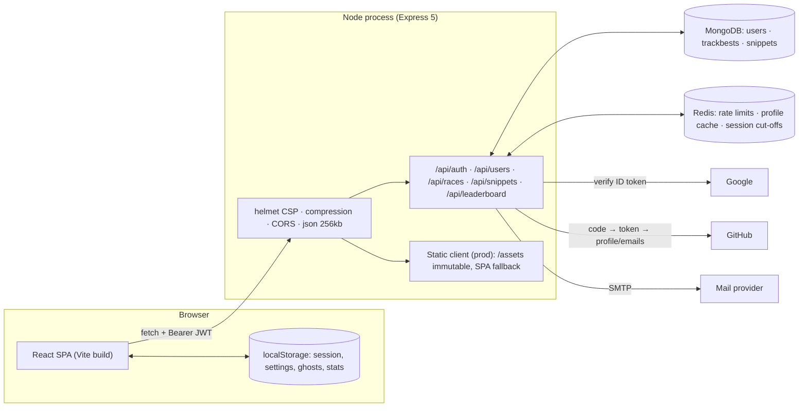
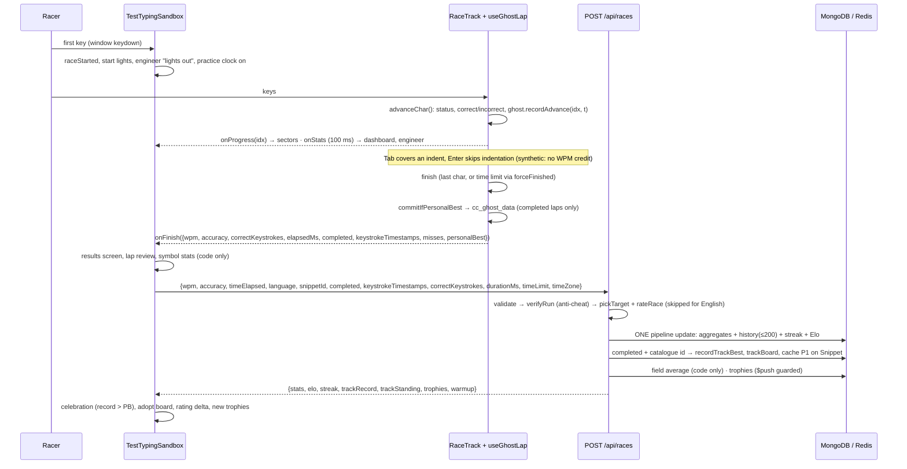

# CodeCaret — Project Context

A complete map of the CodeCaret codebase for contributors and coding agents: what every folder and file does, which technology does what, how the pieces talk to each other, and the rules that must not be broken.

Read this before changing anything. For setup and deployment steps, [README.md](README.md) is the short version; this file is the long one.

---

## Contents

1. [What CodeCaret is](#1-what-codecaret-is)
2. [Technology at a glance](#2-technology-at-a-glance)
3. [Architecture](#3-architecture)
4. [Repository map (every file)](#4-repository-map-every-file)
5. [The life of a lap (end to end)](#5-the-life-of-a-lap-end-to-end)
6. [Server in depth](#6-server-in-depth)
7. [API reference](#7-api-reference)
8. [Client in depth](#8-client-in-depth)
9. [Data and storage](#9-data-and-storage)
10. [Product rules and invariants](#10-product-rules-and-invariants)
11. [Conventions for contributors and agents](#11-conventions-for-contributors-and-agents)
12. [Development, testing, CI and deployment](#12-development-testing-ci-and-deployment)
13. [Known notes](#13-known-notes)
14. [Glossary](#14-glossary)

---

## 1. What CodeCaret is

CodeCaret is a **single-player typing simulator for source code**, themed as Formula 1. You "race" real C++, Python and JavaScript snippets (called **tracks**) against the clock. Every completed run is a **lap**.

Around that core loop it adds:

- **Live telemetry.** WPM, accuracy, sector splits (S1–S3), a WPM trace and a race-engineer radio.
- **Ghost laps.** A second caret replays your best lap, or the record holder's, with keystroke-exact timing.
- **A podium per track.** Every snippet has its own top-3 leaderboard.
- **A global championship.** Peak pace, an Elo-style rating, and a weekly board.
- **Daily streaks and trophies.** Streaks follow your own timezone. Trophies are decided on the server.
- **Special tracks.** A track of the day, challenge links and symbol drills.
- **Lap review.** A per-key heat map, a replay, and "symbol fluency" analysis.
- **Share cards.** A PNG of the lap for social posts.
- **Plain-English warm-up passages.** They never count toward the rating or the global boards.
- **Customisation.** 15 colour themes, 12 typing fonts and 12 synthesised switch sounds, plus many typing modes.
- **3D scenes.** A 3D home page (a scroll-driven hot lap of a night circuit) and a 3D garage on the sign-in and sign-up pages.

Practice needs no account. Signing in (email/password, Google or GitHub) puts laps on boards and syncs settings across devices.

There is **no multiplayer**. An old lobby and race route was removed, and `/lobby` and `/race` redirect to `/test`.

---

## 2. Technology at a glance

| Layer | Technology | Used for |
|---|---|---|
| Client framework | **React 19** + **React Router 7** | SPA, lazy-loaded routes |
| Build | **Vite 8** (`@vitejs/plugin-react`) | Dev server (port 5173, strict), production bundle, code splitting |
| Styling | **Tailwind CSS 4** (`@tailwindcss/vite`) + hand-written CSS files | Utilities plus large component stylesheets; theme tokens via CSS custom properties |
| 3D | **three.js r185**, **@react-three/fiber 9**, **@react-three/drei 10** | Landing-page circuit, auth-page garage, GLB car (Draco-compressed) |
| Post-processing | three's example passes (`EffectComposer`, `UnrealBloomPass`, FXAA, custom lens shader) | Bloom, speed blur and chromatic fringing on the landing page |
| Animation (2D) | **framer-motion 12** | Sign-in and sign-up form micro-animations |
| Charts | **Recharts 3** | WPM trace on the results screen, form chart on driver pages |
| Syntax highlighting | **Prism.js** | Tokenises the snippet into a background layer. On `/test` that layer is deliberately hidden (`opacity: 0`), so untyped code reads in one recessive colour |
| Icons | **lucide-react** | UI icons. Brand logos are hand-drawn SVG |
| Audio | **Web Audio API** (no files) | Synthesised keyboard switch sounds and race cues |
| Share images | **Canvas 2D** → PNG; Web Share API, Clipboard API | Lap share cards |
| OAuth (client) | **@react-oauth/google**; GitHub via a manual redirect | Sign-in buttons |
| Client tests | **Vitest 4** | Pure-logic unit tests |
| Lint | **ESLint 9** (flat config, react-hooks, react-refresh) | |
| Server runtime | **Node.js ≥ 22**, CommonJS | |
| Server framework | **Express 5** | REST API, and serves the built client in production |
| Database | **MongoDB** via **Mongoose 9** | Users, per-track bests, snippet stats rows |
| Cache and coordination | **Redis 5** (`redis` client) | Rate limits, profile cache, session revocation. Optional in dev |
| Auth | **JWT** (`jsonwebtoken`), **bcrypt** (12 rounds) | Bearer-token sessions, password hashing |
| OAuth (server) | `google-auth-library` (ID-token verification), `axios` (GitHub code exchange) | |
| Security headers | **helmet** (strict CSP), `cors`, `compression` | |
| Email | **Nodemailer** over any SMTP | Password-reset links |
| Server tests | `node:test` (built-in) plus an HTTP smoke-test script | |
| CI | **GitHub Actions** | Lint, test, build and audit for both halves |

Size, roughly: about 26k lines of client JS/JSX (excluding the snippet data), about 9.5k lines of client CSS, and about 6.3k lines of server JS.

---

## 3. Architecture



**Deployment shape.** In production one Node process is the whole site. Express serves the API and the built client from the same origin, so no CORS setup is needed and `VITE_SERVER_URL` is left empty. In development, Vite serves the client on `:5173` and the API runs on `:5000`. The API allows `CLIENT_URL` plus any loopback origin when not in production.

**Where state lives:**

- **Authoritative:** MongoDB. It holds accounts, aggregates, rating, streak, trophies, race history (the last 200 laps), per-track bests and ghost timings.
- **Derived or ephemeral:** Redis holds rate-limit counters, a 24-hour cache of each public profile, and per-user "sessions issued before X are revoked" cut-offs. Everything degrades gracefully without Redis.
- **Browser:** localStorage holds the session token, every preference (also synced to the account), your own ghost laps, symbol-fluency totals and daily practice time.
- **Snippet corpus:** static data **bundled into the client** (514 code snippets plus 40 English passages). The server never stores snippet code for these. It only knows their catalogue ids (`cpp-s-1`, `py-m-4`, `daily-2026-10-10`…).

---

## 4. Repository map (every file)

Generated, vendored and binary files are described by group. Everything else is listed individually.

### Root

| Path | Purpose |
|---|---|
| `README.md` | Quick start, configuration, deployment options, go-live checklist, API summary |
| `CONTEXT.md` | This document |
| `.gitignore` | Ignores `node_modules`, `dist`, `.env*` (except `.env.example`), logs, `.vite`, `coverage`, OS files |
| `.vscode/settings.json` | Silences CSS lint for Tailwind's at-rules |
| `.github/workflows/ci.yml` | CI: client (lint, Vitest, build, `npm audit --omit=dev --audit-level=high`) and server (`node --check` on every file, `node --test`, audit) |

> The working copy on disk is **not currently a git repository**, although CI config exists for GitHub. `server/.env` and `client/.env` hold real local secrets and must never be committed.

### `server/` — Express API (CommonJS)

| Path | Purpose |
|---|---|
| `package.json` | Scripts: `start`, `dev` (`node --watch`), `test` (`node --test` unit tests), `smoke` (live HTTP smoke test), `diagnose`. Engines: Node ≥ 22 |
| `.env.example` | Every server setting, documented (see [§12](#environment-variables)) |
| `.env` | Local secrets (not for the repo) |
| `.gitignore` | Ignores `node_modules`, `.env` / `.env.*` (keeps `.env.example`) and logs, so this folder is safe on its own |
| `index.js` | **Entry point.** Env check → helmet/compression/CORS → trust proxy → JSON body (256 KB) → `/health` → connect Mongo and Redis (`Promise.allSettled`) → drop stale indexes (`models/staleIndexes.js`) → mount routes → serve client (prod) → 404 and error handlers → graceful shutdown → listen (`keepAliveTimeout` 65 s) |
| `config/env.js` | `checkEnv()` (pure: returns errors and warnings) and `assertEnv()` (exits on errors). Requires `JWT_SECRET` and `MONGODB_URI`. Production also requires `CLIENT_URL` and a secret of 32+ characters, and warns on non-https, missing Redis or missing SMTP |
| `config/db.js` | `mongoose.connect` (pool 10). On failure it retries in the background with exponential backoff (5 s doubling, capped at 30 s) **and** rethrows |
| `config/redisClient.js` | Singleton node-redis client with a capped reconnect strategy. `connectRedis()` rethrows so boot can report "starting without Redis" |
| `middleware/auth.js` | `authenticate`: Bearer JWT → `req.user = {id, username}`; rejects tokens revoked by a password change. `optionalAuth`: never refuses, just attaches the user when the token is valid |
| `middleware/rateLimit.js` | Fixed-window limiter with no extra dependency. Redis `MULTI INCR + EXPIRE NX + TTL`, with an in-memory `Map` fallback. Sets `RateLimit-*` headers and returns 429 with `Retry-After` |
| `middleware/security.js` | helmet config: strict CSP (self, `'wasm-unsafe-eval'` for Draco, `blob:` workers, Google Fonts, Google sign-in), COOP `same-origin-allow-popups`, CORP `same-site`, referrer policy, HSTS only in production over https |
| `models/User.js` | The account schema (see [§9](#mongodb-collections)). A pre-save hook bcrypt-hashes `authHash`. Indexes: `peakWpm`, `rating_board` |
| `models/Snippet.js` | One row per catalogue track that has been raced, keyed by `catalogId`, with **no code**: a cache of the track record (P1) and the "field average" (`wpmSum`, `raceCount`, `avgWpm`) used as the rating opponent |
| `models/staleIndexes.js` | `dropStaleIndexes()`, run once at boot: drops indexes left by removed features (`users`: `eloRating_-1`, `phone_1`; `snippets`: `category_1`, `category_1_difficulty_1`, `language_1_difficulty_1`). Idempotent |
| `models/TrackBest.js` | One document per (track, racer): that racer's best **completed** lap, with `wpm`, `accuracy`, `timeElapsed`, `achievedAt` and `times[]` (per-character ms, the ghost). Unique on `{catalogId, user}`, plus a board index in ranking order |
| `routes/auth.js` | Register, login (timing-safe with a dummy hash), forgot and reset password, Google and GitHub OAuth, username availability, post-OAuth username pick |
| `routes/users.js` | Own profile get and update, settings blob, password change, account deletion, public driver page |
| `routes/races.js` | **The core write path:** `POST /api/races` (validate → anti-cheat → Elo → one atomic pipeline update → track board → field average → trophies), plus `GET /api/races/history` |
| `routes/snippets.js` | Per-track board (`/:id/leaderboard`, whose P1 is the track record) and ghost (`/:id/ghost`) reads |
| `routes/leaderboard.js` | Global top 50 (`/global`) and `/standings` (peak, rating or weekly, plus the caller's own row) |
| `utils/antiCheat.js` | `verifyRun()`: re-derives WPM from the telemetry and rejects inhuman runs (see [§6.4](#64-anti-cheat-utilsanticheatjs)) |
| `utils/elo.js` | `rateRace()` and `pickTarget()`: Elo against an asynchronous target WPM |
| `utils/raceStats.js` | Builders for aggregation-pipeline stages: `raceStatsUpdate`, `streakUpdate`, `eloUpdate` |
| `utils/streak.js` | Day keys in the racer's IANA zone (`Intl`, `en-CA`), `nextStreak()` as the pure reference |
| `utils/trackBoard.js` | `recordTrackBest` (atomic conditional upsert), `trackBoard` (podium + racer count + you), `trackGhost`, `refreshRecordCache`, `boardSummary`, `cleanTimes` |
| `utils/trophies.js` | `qualifyingTrophies()` and `newTrophies()`: the server decides who earned what |
| `utils/userProfile.js` | `publicUser()` (the one user shape), `cacheUserProfile()`, `passwordProblem()` (the password policy), `validateUsername()`, `generateUsername()` for OAuth, `exactInsensitive()` regex helper |
| `utils/sessions.js` | `revokeSessions()` / `isRevoked()` via Redis `sessions-from:<id>` |
| `utils/token.js` | `signToken(user)`: JWT `{id, username}` with `JWT_EXPIRES_IN` (default `7d`). The only place tokens are minted |
| `utils/mailer.js` | `sendMail()` via Nodemailer. Never throws. Without SMTP it prints the mail to the console in dev |
| `utils/clientApp.js` | `mountClient()`: serves `client/dist` with immutable `/assets`, `no-cache` HTML and an SPA fallback |
| `tests/units.test.js` | `node:test` unit tests: Elo, target picking, streak and day keys, anti-cheat, press collapsing, ghost cleaning, trophies, week start, password policy, env checks |
| `scripts/smokeTest.js` | End-to-end HTTP check against a running server (`SMOKE_URL`). Creates and deletes a `cc_smoke_*` account and a `smoke-*` track |
| `scripts/diagnoseDb.js` | MongoDB connection diagnostics: URI parse (masks the password, flags unencoded characters), SRV DNS lookup, connect test, Atlas advice |
| `package-lock.json` | Lockfile |

### `client/` — React app (ESM)

| Path | Purpose |
|---|---|
| `package.json` | Scripts: `dev`, `build`, `lint`, `test` (`vitest run`), `preview`, `themes` (regenerate palettes) |
| `vite.config.js` | React + Tailwind plugins. A custom `codecaret-site-url` plugin replaces `%SITE_URL%` in `index.html` from `VITE_SITE_URL`. Dev server on **5173 with `strictPort`** (the OAuth callbacks are registered there) |
| `eslint.config.js` | Flat config. Ignores `dist` and `public/draco`. `no-unused-vars` ignores `^[A-Z_]` names |
| `index.html` | Shell: favicons, manifest, Open Graph and Twitter meta (with `%SITE_URL%`), `#root`, `/src/main.jsx` |
| `.env.example` / `.env` | `VITE_SERVER_URL`, `VITE_GOOGLE_CLIENT_ID`, `VITE_GITHUB_CLIENT_ID`, `VITE_SITE_URL` |
| `.gitignore` | Vite template ignores, plus `.env` / `.env.*` (keeps `.env.example`) and `.vercel`, so this folder is safe on its own |
| `vercel.json` | Vercel config for split hosting. **Rewrite:** every path except `/assets/*` → `/index.html`, so client routes survive a refresh while a missing hashed chunk is a real 404. **Cache:** `/assets/*` one year `immutable`; `/draco/*` and the GLB 7 days with `stale-while-revalidate` (their names never change). **Security headers** mirroring `server/middleware/security.js`: CSP (self, Google sign-in, Google Fonts, `wasm-unsafe-eval` and `blob:` workers for Draco, `frame-ancestors none`; `connect-src` must list the API origin, currently `https://*.onrender.com`), COOP `same-origin-allow-popups`, CORP `same-site`, referrer policy, HSTS (no preload), `nosniff` |
| `package-lock.json` | Lockfile |

#### `client/public/` — served as-is

| Path | Purpose |
|---|---|
| `f1-car-transformed.glb` | The 3D F1 car (2.8 MB, Draco-compressed, about 1.6M triangles in three meshes merged by material) |
| `draco/` | three's prebuilt Draco decoder (`draco_decoder.js/.wasm`, `draco_wasm_wrapper.js`), vendored. Loaded from `/draco/` |
| `logo.png`, `logo-mark.png` | Wordmark (the mark has its paper knocked out to alpha) |
| `favicon-32/64.png`, `apple-touch-icon.png`, `icon-192/512.png`, `icon-maskable-512.png` | Icons |
| `manifest.webmanifest` | Installable PWA metadata (`start_url: /test`, standalone) |
| `og-image.png` | 1200×630 link-preview image, rendered from `scripts/og-image.svg` |
| `robots.txt` | Disallows `/profile`, `/reset-password` and `/forgot-password` |

#### `client/scripts/` — one-off generators (Node)

| Path | Purpose |
|---|---|
| `genThemes.cjs` | **Single source of truth for all 15 palettes.** Checks WCAG contrast gates (body text ≥ 7:1, accent ≥ 4.5:1, and so on) and that error and accent are distinguishable. Only if every palette passes does it rewrite the palette blocks inside `src/themes.css` (between markers) and `src/themeRegistry.json`. Run with `npm run themes` |
| `labelSnippets.cjs` | Stamps `length` (from the real line count: ≤5 short, ≤15 medium, else long), `topic`, `tags` and `difficulty` onto every code snippet, using ordered regex rules and exact-title overrides. Fails loudly on any unmatched title. `--check` reports without writing |
| `og-image.svg` | Hand-drawn source composition for `public/og-image.png` |

#### `client/src/` — application code

**Entry and app shell**

| Path | Purpose |
|---|---|
| `main.jsx` | Applies the saved theme before first paint. Reloads once (at most every 10 s) on `vite:preloadError` (stale chunks after a deploy). Tree: `StrictMode > AppErrorBoundary > BrowserRouter > AuthProvider > GoogleOAuthProvider (only if a client id is set) > App` |
| `App.jsx` | Routes (every page `React.lazy`), `PageFallback`, `ScrollToTop`, the 404 page, the global `UsernameSelectionModal`, and the Navbar (hidden on `/`, `/test` and the auth pages). `/test` is keyed on `settingsVersion` so adopted account settings remount the simulator |
| `config.js` | `API_URL` / `apiUrl()` (empty = same origin; dev defaults to `http://localhost:5000`), `GOOGLE_CLIENT_ID`, `GITHUB_CLIENT_ID`. **All network calls resolve their base URL here** |
| `index.css` | Google Fonts import (Fira Code, Inter, JetBrains Mono, Kaushan Script, Saira), Tailwind, `themes.css`, `@theme` tokens, base typography rules, caret pulse, `.rt-code-layer` shared code typography |
| `themes.css` | **Generated** palette blocks (`:root[data-theme="…"]` with `--cc-*` tokens), plus a hand-written bridge mapping Tailwind's `--color-*` tokens to `--cc-*` |
| `themeRegistry.json` | **Generated** list of themes (id, label, blurb, dark/light scheme, swatch) |
| `themes.js` | `THEMES`, `THEME_GROUPS`, `getTheme`, `getStoredTheme`, `applyTheme` (sets `data-theme` on `<html>` and persists `cc_theme`) |
| `fonts.js` | The 12 typing fonts (ids are stored in `cc_globalFont`). `fontStack()` feeds `--global-font` |
| `assets/ckl.png` | The results-screen hero car art (2.2 MB). Keep it; the owner chose it |

**State and context**

| Path | Purpose |
|---|---|
| `context/useAuth.js` | `AuthContext` and the `useAuth()` hook (a separate file so Fast Refresh works) |
| `context/AuthContext.jsx` | `AuthProvider`: session in `cc_token` / `cc_user` (migrates legacy `token` / `user`), revalidation via `/api/users/me`, cross-tab sync, login, register, Google, GitHub, pending OAuth sign-up held **in memory only** until a username is confirmed, settings adoption and push (debounced 1.2 s, `keepalive`), profile update, password reset, change and delete, `handleUnauthorized` (any 401 signs the app out) |

**Hooks**

| Path | Purpose |
|---|---|
| `hooks/useGhostLap.js` | Records per-character arrival times during a lap. Stores your best per snippet in `cc_ghost_data` (max 50, oldest evicted). Replays it as a cursor (`indexAt`, an amortised O(1) forward cursor). Can replay an override lap (the record holder's) when lengths match |
| `hooks/useTypingSound.js` | Web Audio synthesis. 12 switch profiles plus off, built from layers: sine "sub" thump, high-Q bandpass noise "body", highpass "click" (plus an optional second click). Master ×3 → compressor → trim 0.8. Also an error sound, start lights, chequered chime, a personal-best chime and a track-record Doppler fly-by |
| `hooks/usePracticeTracker.js` | Daily active-practice clock. It ticks only while a race is running, caps each credit at 2 s (handles throttled tabs), and fires the goal alarm once a day. Stored in `practice_stats` and `practice_goal_ms` |
| `hooks/useTrackBoard.js` | Fetches `/api/snippets/:id/leaderboard` (with the token, so `you` is included). Responses are stamped with the track id and requests are aborted on change. `adopt()` takes the board returned with a race result |
| `hooks/useGithubCallback.js` | Completes the GitHub redirect on `/signin`: checks `state` against `sessionStorage.cc_oauth_state` (CSRF), exchanges `code` once (guarded against StrictMode double effects), and clears the query string |

**Utilities** (`utils/`)

| Path | Purpose |
|---|---|
| `snippetPool.js` | The catalogue (`CATALOGUE` = code + English), languages (`CODE_LANGUAGES`; `English` is a warm-up and exclusive), Prism keys, symbol-density bands (light < 0.22 ≤ medium < 0.27 ≤ heavy), 19 topics, `poolFor()` (relaxes density → length → topic, **never** language), `pickSnippet()` (avoids repeating the current track; `null` when nothing matches), `drawSnippet()` (the same, but falls back to a real track so the page always has one), `formatRaceTime()` |
| `codeSnippets.js` | C++ and Python base sets (`cpp-s/m/l-*`, `py-s/m/l-*`), spreading in the other three files into one array of **514** |
| `javascriptSnippets.js` | 100 JavaScript snippets (`js-s/m/l-*`) |
| `extraSnippets.js` | 124 second-wave snippets for thin topics (`cpp-x-*` 44, `py-x-*` 40, `js-x-*` 40) |
| `topicFillSnippets.js` | 90 third-wave snippets for thin language × topic cells (`cpp-t-*`, `py-t-*`, `js-t-*`) |
| `englishPassages.js` | 40 original plain-ASCII warm-up passages (`en-s-*` 14, `en-m-*` 14, `en-l-*` 12) |
| `lapAnalysis.js` | Per-character durations, lap heat map (levels 0–4), symbol fluency against your lowercase-letter baseline, running totals across laps (`cc_symbol_stats`) |
| `symbolDrill.js` | `drillScore()` and `pickDrillSnippet()`: a track dense in the symbols that slow you down |
| `specialTracks.js` | Track of the day (FNV-1a hash of the UTC date over medium code tracks; board id `daily-YYYY-MM-DD`), challenge links (`/test?track=…&vs=…&by=…`), drill links (`/test?drill=…`) |
| `trophies.js` | Display data for the 12 trophies (title, blurb, tier, glyph). The server decides who earns them |
| `settingsRegistry.js` | **The one list of synced preferences** (`cc_*` keys, defaults, and serialisation kind). `collectSettings` / `applySettings` (known keys only) / `resetSettings` / `defaultSettings` |
| `safeStorage.js` | `readString`, `readJSON`, `readNumber`, `readEnum` and `write`. They never throw, so a corrupt key cannot white-screen the app |
| `typingTarget.js` | `isEditableTarget()`: window-level race key listeners ignore keys aimed at inputs, textareas, selects and contenteditable elements |
| `*.test.js` | Vitest: `snippetPool.test.js`, `lapAnalysis.test.js`, `specialTracks.test.js` |

**Pages** (`pages/`)

| Path | Route | Purpose |
|---|---|---|
| `SignInPage.jsx` | `/signin` | Email + password form beside the 3D garage (car pre-assembled, auto-rotating, a "systems check" boot sequence). Also the **GitHub OAuth callback** page |
| `SignUpPage.jsx` | `/signup` | `AuthLayout` + `F1AssemblyForm` |
| `ForgotPasswordPage.jsx` | `/forgot-password` | Requests a reset email (the reply is always the same) |
| `ResetPasswordPage.jsx` | `/reset-password?token=` | Sets a new password with the 64-hex token, then signs in |
| `DriverPage.jsx` | `/driver/:username` | Public driver page (`DriverView`) |

**Components** (`components/`)

| Path | Purpose |
|---|---|
| `TestTypingSandbox.jsx` | **The `/test` simulator page (about 2,100 lines).** Owns every race setting (seeded from localStorage, persisted, pushed to the account), snippet selection, special tracks, the F1 dashboard, start detection, the time limit, sectors, the WPM history, the finish handler that **submits the lap**, celebrations, the share-card data, and keyboard shortcuts (Tab+Enter restart, Esc). Renders `RaceTrack`, `VirtualKeyboard`, `SettingsModal`, `LeaderboardModal`, `ResultsScreen`, `ShareCardDialog`, `Onboarding`, `PracticeGoalAlert` and the radio toasts |
| `TestTyping.css` | Styles for the whole simulator, its modals and the results screen (about 4.3k lines, scoped under `.light-typing-sandbox`). Imports the 11 extra typing-font families |
| `RaceTrack.jsx` | **The typing engine.** Renders only the code display: a Prism `<pre>` behind (hidden on `/test`) and a per-character `<span>` overlay in front for correct, incorrect, active or pending. It listens to `keydown` on `window`. Handles backspace rules (freedom mode), strict mode, Tab covering 2–4 space indents, Enter auto-skipping indentation and blank lines (synthetic advances earn no WPM), and a 100 ms stats broadcast. Live numbers stay in refs and reach the page through `onStats` / `onFinish`; the page owns every readout. The caret and ghost caret are positioned by direct DOM writes, and the ghost runs on a requestAnimationFrame loop. On finish it hands over stats, `keystrokeTimestamps`, per-character `misses` and the personal-best result |
| `VirtualKeyboard.jsx` / `.css` | ANSI keyboard with zero re-renders: key DOM nodes are kept in a `Map` by `e.code`. An imperative handle (`setExpectedKey`, which lights the next key plus the opposite-hand Shift, and `flashFeedback`). Mirrors CapsLock |
| `useRaceEngineer.js` | "Race engineer" radio toasts (good start, purple sector, DRS at 100 WPM, pace drop, accuracy below 95%, chequered flag). Cooldowns, max 3 toasts, verbosity off / critical / full |
| `race/ResultsScreen.jsx` | Chequered-flag screen: record or personal-best banner, warm-up note, new trophies, challenge verdict, a "lap not recorded" error, track standing, stats, rating delta, sectors, the Recharts WPM trace, `LapReview`, and actions (Enter = next track, retry, share) |
| `race/LapReview.jsx` | Heat-mapped lap text, a replay at 1×/2×/4× (DOM writes on a rAF loop), symbol fluency, and a "drill these symbols" button |
| `race/SettingsModal.jsx` | "Race Configuration": languages (English exclusive), topic, symbol density, length, time limit (15/30/60/120/none), custom snippet, daily goal, caret style, strict, indentation, freedom, keyboard, zen, hide WPM, blind, highlight mode, caret blink and smooth, ghost on/off and source, sound profile and volume, engineer verbosity, font size, line height and family, theme ("Livery"), and reset all |
| `race/Onboarding.jsx` | First-visit tips dialog (`cc_onboarded`) |
| `race/TouchTypingInput.jsx` | Phones and tablets: a transparent textarea over the code. `beforeinput` and composition text are replayed as synthetic `keydown` events on `window`, so the same engine works. Straightens curly quotes |
| `PracticeGoalAlert.jsx` | The "daily target met" panel (dismisses itself after 8 s) |
| `LeaderboardModal.jsx` / `.css` | Two tabs: **This track** (podium + you) and **Global** (top 50 by peak WPM) |
| `Standings.jsx` | `/standings` championship table with tabs (peak, rating, weekly), a podium, and the viewer's pinned row |
| `Profile.jsx` | `/profile`: your `DriverView` plus private cards (symbol fluency from localStorage, account edit, password change, delete account) |
| `driver/DriverView.jsx` | Shared driver page body: header, stats, trophy cabinet, activity calendar, form chart (Recharts; warm-ups excluded), per-language table, recent laps |
| `driver/ActivityCalendar.jsx` | GitHub-style 53-week SVG heat map (UTC days) |
| `driver/TrophyBadge.jsx` | SVG medal per trophy (bronze, silver, gold or locked steel) with an emblem glyph |
| `driver/Driver.css` | Styles for driver pages and standings |
| `share/ShareCardDialog.jsx` / `.css` | "Share your lap" dialog: format picker (square, story, wide; remembered in `cc_shareFormat`), preview, native share sheet on touch devices, copy image, download, and per-platform composers |
| `share/raceCard.js` | Draws the share card on a Canvas 2D (carbon weave, chequered flag, speed trace, tiles, logo) at 1080×1080, 1080×1920 or 1600×900, and encodes it as PNG. `loadCardAssets()` preloads fonts and the logo |
| `share/shareTargets.js` | Caption text, file name, capability checks, download, clipboard, Web Share, and platform composer URLs (WhatsApp, X, LinkedIn, Instagram, Facebook, Telegram) |
| `share/BrandMarks.jsx` | Hand-drawn SVG platform logos |
| `share/shareTargets.test.js` | Vitest |
| `UsernameSelectionModal.jsx` | Mandatory "driver ident" picker after an OAuth sign-up. Debounced availability check (350 ms) via `/api/auth/check-username`, then `confirmUsername()` |
| `F1AssemblyForm.jsx` | Sign-up form. The first three validated fields each fit part of the 3D car (email → chassis, name → wheels, username → aero); the password arms the stage (`secure`: the plinth pulses and the floor light comes on). Declares `PASSWORD_RULES` (mirrors the server's `passwordProblem()`), a strength meter and a checklist |
| `F1Car.jsx` | The assembling GLB car for the auth pages, in three parts (chassis, wheels, aero). Splits the rubber mesh into 4 wheels, animates the parts with frame-rate-independent damping, and handles the "launch" on successful sign-in |
| `f1/AuthLayout.jsx` | Auth page frame: backdrop glow plus seeded film grain, two columns, and a frosted `AuthPanel` |
| `f1/CarStage.jsx` | The left column: lazily loads `StageCanvas`, a zoom box (ctrl/⌘-wheel, Safari gesture events, ± buttons) and overlay furniture |
| `f1/StageCanvas.jsx` | R3F `<Canvas>` (PCF shadows, dpr 1–2, frameloop held until shaders are precompiled), camera, OrbitControls (drag only), studio `Environment` with `Lightformer`s, `ContactShadows`, the car, the pedestal and the circuit |
| `f1/CircuitScene.jsx` | Procedural night start/finish straight: wet asphalt (`Reflector` mirror), kerbs, pit wall with LED boards, garages, gantry and floodlights. All textures are drawn on canvases |
| `f1/PitLane.jsx`, `f1/StandSide.jsx`, `f1/Trackside.jsx` | Instanced pit crews, cars and gantries; the grandstand side (crowd tiers, safety car, timing board); the logo painted on track, marshals and a TV camera |
| `f1/Pedestal.jsx` | Display plinth with canvas-drawn deck and HUD rings, sized from the car's bounds |
| `f1/trackPeople.jsx`, `f1/circuitParts.jsx`, `f1/circuitKit.js` | Figures, flags, marshal posts and TV cameras; `Matte`, `ProxyCar` and `Instances` helpers; layout constants, team colours and canvas/texture helpers (`makeCanvas`, `mulberry32`) |
| `f1/carGeometry.js` | `MODEL_URL`, `FIT`, Draco decoder path, `wheelsOf()` and `paintedBodyOf()` (cached mesh splitting, shared with the landing car) |
| `f1/carPaint.js` | Shared `MeshPhysicalMaterial`s: crimson clearcoat paint and carbon metal |
| `f1/theme.js` | Auth-scene constants (colours, camera, zoom range, floor height, telemetry channel states) |
| `f1/chrome.jsx`, `f1/TelemetryField.jsx` | Panel furniture (grid, corner marks, readout header, segment meter) and the "telemetry channel" form field |
| `f1/OAuthButtons.jsx` | Google `GoogleLogin` button and the GitHub authorize redirect (`state` in sessionStorage, scope `read:user user:email`). A button renders only when its client id is configured |
| `f1/StageBoundary.jsx` | Error boundary that hides the 3D stage if WebGL or the model fails; the form keeps working |
| `LandingPage.jsx` / `.css` | **Home page `/`.** A tall empty spacer whose scroll position drives one hot lap. A rAF frame loop runs a critically damped spring with car speed limits (`driveStep`), handles the start lights (red, green, amber), the lap clock, chapter jumps (with a fade-to-black "cut" over 450 m), and the "Watch the full lap" autopilot, then pushes values to the HUD and panels through refs (**no React re-renders while scrolling**). Shows a lights loader. Falls back to a static backdrop without WebGL |
| `landing/LandingScene.jsx` | R3F canvas for the lap: `PerformanceMonitor` drops dpr when slow, quality tiers for small or low-core devices, ordered `useFrame` priorities (pose rig → camera → scene → PostFX), shader warm-up before reveal |
| `landing/lapStore.js` | The mutable `lap` object the frame loop writes and everything reads. `springStep` and `driveStep` |
| `landing/trackLayout.js` | The 2,160 m circuit built by integrating a curvature profile (raised-cosine corners); sampled into typed arrays every 0.5 m. Sector and finish markers |
| `landing/scrollMap.js` | Non-linear scroll ↔ metres map (dwell while a copy panel is up; quotes get a fixed scroll budget). `SCREENS` sets the page height |
| `landing/content.js` | All home-page copy, quotes, radio lines and sectors, positioned in metres along the lap. **The numbers in the copy are real counts — keep them in sync** |
| `landing/rig.js` | Per-frame pose of the car, ghost, camera and lamp from `lap` (no allocations) |
| `landing/choreography.js` | Ghost-car script for the "beat the ghost" stretch |
| `landing/TrackMeshes.jsx`, `Gantries.jsx`, `SetPieces.jsx`, `World.jsx` | Swept track deck with faked floodlight pooling in shaders; start, sector, DRS and finish gantries (fireworks); holographic feature installations; sky, city, floor and drifting code glyphs |
| `landing/RaceCar.jsx`, `GhostCar.jsx`, `CarFX.jsx` | The GLB car on rails (sprung body, steering, rolling wheels); the ghost as about 75k points sampled from the model; trails, sparks and air streaks |
| `landing/PostFX.jsx` | EffectComposer: render → UnrealBloom → custom lens (radial blur, chromatic aberration, vignette, grain) → output → FXAA |
| `landing/Hud.jsx`, `landing/Sections.jsx` | HTML HUD (lights, speed and gear, lap clock, sectors, minimap, radio, chapter menu) and copy panels (all in the DOM for accessibility and SEO; driven by a `--v` CSS variable; off-screen panels are `inert`) |
| `landing/holo.js`, `textures.js`, `accent.js`, `themeAccent.js` | Hologram shader plumbing; canvas-drawn textures (fonts and logo loaded first); scene accent uniforms that follow the theme (light themes keep the brand red); reading the accent from CSS without importing three.js |
| `landing/scrollMap.test.js` | Vitest |
| `Navbar.jsx` | Top nav on standings, profile and driver pages |
| `BrandLogo.jsx` | The logo `` with tone (auto, light or dark) via CSS filter |
| `AppErrorBoundary.jsx` | Last-resort error screen (reload, or go home) |
| `OffTrackArt.jsx` | SVG art for the 404 page (the car beached in the gravel) |

---

## 5. The life of a lap (end to end)



Key details:

- **Telemetry shape.** `keystrokeTimestamps[i]` is the elapsed ms at which the caret *passed character i*. It is one entry per character, not per key press. Auto-advanced runs (Tab over an indent, the skip after Enter) share one timestamp. The same array is the ghost, the server's verification input, and the lap-review data.
- **WPM formula.** Everywhere it is `correctKeystrokes / 5 / minutes`. Accuracy is `correct / (correct + incorrect)`. Synthetic advances are excluded from both.
- **Celebrations.** A track record outranks and replaces a personal best. A first-ever completion is *not* celebrated. The UI waits for the server's verdict (`recordPending`) so only one banner and one sound play.
- **Signed out.** Laps still run, ghosts are still saved locally, and nothing is submitted. The results screen offers sign-in.
- **Failures.** If a submission is rejected or fails, the results screen shows "Lap not recorded" with the reason. A 401 signs the app out.

---

## 6. Server in depth

### 6.1 Boot (`index.js`)

1. `dotenv` loads `server/.env`. `assertEnv()` exits with a list of problems if the config is invalid.
2. Middleware order: `securityHeaders` (helmet) → `compression` → `cors` (production: exactly `CLIENT_URL`; development: plus any `localhost` / `127.0.0.1` / `[::1]` origin on any port) → `trust proxy` (parsed from `TRUST_PROXY`: true/false, a hop count, or an address list) → `express.json({limit: "256kb"})`.
3. `GET /health` returns `{status, uptime, timestamp, services: {mongo, redis}}`. It returns 200 if Mongo is connected, otherwise 503.
4. Datastores connect in parallel. The server **starts even if both are down**; Mongo keeps retrying in the background. `app.locals.redis` is the shared client.
5. Routes mount, then the client (production, or `SERVE_CLIENT=true`; disabled by `SERVE_CLIENT=false`), then a JSON 404 and a central error handler (generic message in production).
6. Graceful shutdown on SIGTERM/SIGINT (10 s forced exit). `uncaughtException` shuts down; `unhandledRejection` only logs.

### 6.2 Authentication and sessions

- **Sessions are JWTs** (`{id, username}`, `JWT_EXPIRES_IN`, default 7 days), sent as `Authorization: Bearer`. The client stores the token in localStorage.
- **Revocation.** A password change or reset writes `sessions-from:<userId> = now (s)` in Redis (30-day TTL). `authenticate` rejects tokens with `iat` before that. The device that made the change gets a fresh token. Without Redis this check is skipped.
- **Renames re-issue the token** (`PATCH /me`, `PUT /auth/update-username`), because routes read `req.user.username` from the token.
- **Password policy** (`passwordProblem`): 8–128 characters, with an uppercase letter, a digit and a symbol. It is shared by register, reset and change, and mirrored in the client's `PASSWORD_RULES`.
- **Usernames** (`validateUsername`): 3–24 characters of `[a-zA-Z0-9_.-]`. Uniqueness is **case-insensitive** (`exactInsensitive` regex), although the index itself is case-sensitive.
- **Login** always runs a bcrypt compare (against a dummy hash when no account matches) and returns one generic error, so account existence never leaks.
- **Password reset.** A random 32-byte hex token is emailed. Only its SHA-256 is stored, with a 30-minute expiry, and it can be used once. `forgot-password` replies identically whether or not the account exists. OAuth-only accounts receive a "you sign in with Google/GitHub" email instead.
- **OAuth:**
  - *Google:* the client gets an ID token from `GoogleLogin`. The server runs `OAuth2Client.verifyIdToken` with `audience = GOOGLE_CLIENT_ID`.
  - *GitHub:* the client redirects to `github.com/login/oauth/authorize` with `redirect_uri = <origin>/signin`, scope `read:user user:email`, and a random `state` kept in sessionStorage. `/signin` then posts the `code`. The server exchanges it (with the same `redirect_uri` derived from `CLIENT_URL`), then reads `/user` and `/user/emails`. Trace logs record shapes and statuses, never secrets.
  - *Account resolution* (`findOrCreateOAuthUser`): first by provider id; then **link by email only if the provider says it is verified**; otherwise create a new account (no `authHash`, username generated from the login, name or email stem). New accounts return `isNewOAuthUser: true`. The client then holds the session in memory and forces the username picker.

### 6.3 Race submission (`routes/races.js`)

Validation:

- `wpm` must be in 0–500.
- `accuracy` must be in 0–100.
- `timeElapsed` must be in 0 s – 3 h.
- `language` must be one of: javascript, typescript, python, cpp, c++, c, java, sql, css, json, bash, english.
- `snippetId` must match `/^[a-z0-9][a-z0-9-]{0,39}$/i`. A bad id is dropped, not rejected; the lap still counts but can't go on a board.

Then:

1. **Anti-cheat** `verifyRun()` runs *before any write*. A rejection returns 400 with `reason` and logs the details.
2. **Rating** (skipped for warm-ups). Read the snippet row, `pickTarget()`, read the current rating, then `rateRace()`.
3. **One atomic `findByIdAndUpdate` aggregation pipeline** (`updatePipeline: true`) containing:
   - `raceStatsUpdate`: `peakWpm` max, `totalRaces`, `wpmRaces`, `wpmSum`, `averageWpm = round(sum / races)`, with backfill for legacy documents. Warm-ups instead only append history.
   - Race history appended and sliced to the last 200.
   - `streakUpdate`: decided inside Mongo against `lastRaceDay`.
   - `eloUpdate`: `$add` the delta, clamped to 100–3000 inside the pipeline.

   This is what makes double submissions and concurrent laps safe.
4. Cache the public profile in Redis.
5. **Track board** (completed laps with a catalogue id only): `recordTrackBest` → `trackBoard` → copy P1 into the `Snippet` record cache. Failure here never fails the submission.
6. **Field average** (code only). First upsert the row with a plain update (to get schema defaults), then a pipeline that adds to `wpmSum` and `raceCount` and recomputes `avgWpm`. It is awaited so the next race reads a fresh opponent.
7. **Trophies.** `qualifyingTrophies()` minus those already held, then `$push` guarded by `trophies.id $nin`.
8. Respond with `201`: `{message, trophies, warmup, stats, trackRecord, trackStanding, streak, elo, currentStreak, eloRating, eloDelta}`.

### 6.4 Anti-cheat (`utils/antiCheat.js`)

`verifyRun(clientWpm, timestamps, timeLimit, completed, {correctKeystrokes, durationMs})` refuses a lap when any of the following holds:

- A **completed** lap carries no telemetry. An empty incomplete lap is allowed.
- There are more than 20,000 entries, or an entry is non-finite, negative, or goes backwards.
- `correctKeystrokes` is greater than the number of characters.
- The span is 0 ms (a paste).
- The recomputed WPM is over the **300 WPM biological limit**. The recomputation is `correct / 5 / (max(span, durationMs) / 60000)`. Using the larger denominator means the client can only lower its own score.
- The client's figure drifts more than **5 %** from the recomputed one.
- The effective duration is longer than `timeLimit + 2 s`.
- With 12 or more key presses (equal timestamps are collapsed into one press): more than 3 gaps of ≤ 1 ms, or a standard deviation of gaps under **12 ms** (machine-even typing).

### 6.5 Rating (`utils/elo.js`)

This is Elo for an asynchronous time trial:

- **Opponent:** a target WPM. The snippet's **field average** (`avgWpm`) is preferred. If there is none, the record holder's WPM is used, unless the racer holds that record. With neither, the lap is **unrated**.
- **Opponent rating** = `800 + 8 × targetWpm`, so a 50 WPM field equals 1200, the starting rating.
- **Actual score** is continuous: `1 / (1 + 10^((target − wpm) / 25))`. It is not win/lose. Expected score is classical Elo.
- **Delta** = `round(32 × (scored − expected))`. The rating is clamped to 100–3000, and the reported delta is the change actually applied.
- Accuracy is not a separate term, because WPM already counts only correct keys.

### 6.6 Streaks (`utils/streak.js` + `raceStatsUpdate`)

- The client sends its IANA `timeZone`. An invalid zone falls back to UTC.
- Day keys are `YYYY-MM-DD` built with `Intl.DateTimeFormat("en-CA", {timeZone})`. "Yesterday" means 24 h earlier, reformatted.
- Inside the pipeline:
  - The same day keeps the streak.
  - Yesterday adds 1.
  - A day earlier than the stored one (zone hopping) changes nothing.
  - Anything else resets to 1.
- `lastRaceDay` only moves forward (`$max` on ISO strings). `maxStreak` is computed in a second stage.

### 6.7 Track boards (`utils/trackBoard.js`)

- **One ranking everywhere:** `wpm desc → accuracy desc → achievedAt asc (first to set it) → _id`.
- `recordTrackBest`: a conditional upsert whose filter matches only a stored best that this lap beats. A duplicate-key error (11000) is the normal "not a personal best" outcome; the simultaneous-first-laps race is retried as a plain update. A new best replaces `times`, or unsets it when the lap has none.
- `trackBoard(catalogId, viewerId)`: an aggregate that sorts, overfetches 10, `$lookup`s live usernames (so renames show up immediately), skips laps of deleted accounts, and keeps 3. It also returns `racers` (a count) and `you = {position, onPodium, wpmToPodium, …}`.
- `trackGhost`: the best lap that has timings, and whether it is the record.
- **The "track record" is simply P1 on the board.** `Snippet.record*` fields are only a cache that steers the rating opponent.
- Deleting an account deletes its `TrackBest` rows and refreshes each affected track's cached record.

### 6.8 Standings (`routes/leaderboard.js`)

- On the board means `totalRaces > 0 && peakWpm > 0`.
- `peak`: sort by `peakWpm`, then `averageWpm`, then `_id`.
- `rating`: sort by `eloRating`, then `peakWpm`, then `_id`.
- `weekly`: an aggregate over `raceHistory` since **Monday 00:00 UTC**, excluding English and 0-WPM laps, ranked by the week's best, then the week's average.
- Top 50, plus a `you` row computed by counting the drivers strictly ahead.

### 6.9 Trophies

Twelve ids: `first-lap`, `streak-3`, `streak-7`, `streak-30`, `daily` (a completed `daily-*` board), `races-50`, `wpm-60`, `wpm-100`, `flawless` (100 % on a completed lap), `podium` (P1–3), `record`, `polyglot` (raced C++, Python and JavaScript).

Warm-up laps can earn only `first-lap`, the streak trophies and `daily`.

Trophies are stored as `{id, at}` on the user. How each one looks is defined only in the client (`utils/trophies.js`, `TrophyBadge.jsx`).

---

## 7. API reference

All bodies are JSON. "Auth" means `Authorization: Bearer <jwt>`. Errors are `{error}`, and sometimes also `{reason}` or `{retryAfter}`.

| Method & path | Auth | Rate limit | Body / query | Returns |
|---|---|---|---|---|
| `POST /api/auth/register` | — | 20 / h | `{username, email, password, fullName?}` | `201 {token, user}` · 409 taken |
| `POST /api/auth/login` | — | 20 / 15 min | `{email, password}` | `{token, user}` · 401 generic |
| `POST /api/auth/google` | — | 30 / 15 min | `{credential}` | `{token, user, created, isNewOAuthUser}` · 503 if unconfigured |
| `POST /api/auth/github` | — | 30 / 15 min | `{code}` | same as Google · 401 bad code · 403 unverified email · 502 GitHub down |
| `POST /api/auth/forgot-password` | — | 5 / 15 min | `{email}` | always `{message}` |
| `POST /api/auth/reset-password` | — | 10 / 15 min | `{token (64 hex), password}` | `{token, user}` |
| `GET /api/auth/check-username/:username` | — | 120 / 5 min | — | `{username?, available, reason}` (200 even when invalid) |
| `PUT /api/auth/update-username` | ✓ (pending OAuth token) | — | `{username}` | `{token, user}` |
| `GET /api/users/me` | ✓ | — | — | `{user}` |
| `PATCH /api/users/me` | ✓ | — | `{fullName?, username?}` | `{user, token?}` (token only on a rename) |
| `PUT /api/users/me/settings` | ✓ | — | `{settings}` (object, ≤ 32 KB) | `{settings}` |
| `PUT /api/users/me/password` | ✓ | 10 / 15 min | `{currentPassword, newPassword}` | `{token, user}`; revokes other sessions |
| `DELETE /api/users/me` | ✓ | 10 / 15 min | `{password}` or, for OAuth accounts, `{confirmUsername}` | `{message}` |
| `GET /api/users/:username/public` | — | 60 / min | — | `{username, joinedAt, peakWpm, averageWpm, totalRaces, eloRating, currentStreak, maxStreak, trophies, peakRank, board:{tracks,records,podiums}, activity:{YYYY-MM-DD:n}, languages[], recent[20]}` |
| `POST /api/races` | ✓ | 30 / min | see [§5](#5-the-life-of-a-lap-end-to-end) | `201 {…}` · 400 validation or telemetry |
| `GET /api/races/history` | ✓ | — | — | `{stats, history (newest first, ≤ 200)}` |
| `GET /api/snippets/:id/leaderboard` | optional | — | — | `{catalogId, podium[≤3], racers, you}` |
| `GET /api/snippets/:id/ghost` | — | — | — | `{snippetId, ghost: {username, wpm, accuracy, achievedAt, times, isRecord} \| null}` |
| `GET /api/leaderboard/global` | — | — | — | top 50 `[{rank, username, peakWpm, averageWpm, totalRaces}]` |
| `GET /api/leaderboard/standings?board=peak\|rating\|weekly` | optional | — | — | `{board, rows[≤50], you, since?}` |
| `GET /health` | — | — | — | 200 / 503 with service states |

**Public user shape** (`publicUser`): `{id, username, email, fullName, peakWpm, averageWpm, totalRaces, eloRating, currentStreak, maxStreak, trophies, authProvider, createdAt, settings}`.

---

## 8. Client in depth

### 8.1 Routing and loading

Every page is a lazy chunk. The heavy parts load separately: three.js scenes (`StageCanvas`, `LandingScene`), the share dialog and card renderer (prefetched 1.2 s after a lap finishes), and the snippet catalogue (only with `/test`).

| Route | Page | Notes |
|---|---|---|
| `/` | `LandingPage` | No navbar. 3D scroll lap |
| `/test` | `TestTypingSandbox` | No navbar. Query params: `track`, `vs`, `by`, `drill` |
| `/signin`, `/signup` | 3D garage auth pages | `/login` and `/register` redirect here |
| `/forgot-password`, `/reset-password` | Password recovery | |
| `/standings` | Championship table | `?board=peak\|rating\|weekly` |
| `/profile` | Your profile | Redirects to `/signin` when signed out |
| `/driver/:username` | Public driver page | |
| `/lobby`, `/race` | → `/test` | Legacy multiplayer paths |
| `*` | 404 "Off the track" | |

### 8.2 Settings: local first, synced to the account

1. Each preference is a `cc_*` localStorage key, listed in `utils/settingsRegistry.js` with its default and serialisation kind.
2. `TestTypingSandbox` seeds about 25 pieces of state from storage at mount (via `safeStorage`). An effect writes them back on change and calls `pushSettings()` (debounced, after auth finishes loading).
3. On sign-in or `/me`, `adoptSettings()` writes the account's blob into storage (known keys only). If anything changed it applies the theme and bumps `settingsVersion`, which remounts `/test` so the state re-seeds.
4. The server stores the blob opaquely (`User.settings`, Mixed, ≤ 32 KB).

Not synced: `cc_token`, `cc_user`, `practice_stats`, ghosts, symbol stats, `cc_onboarded`, `cc_shareFormat`.

**To add a setting:** add it to `SETTINGS` in the registry, seed and persist it in `TestTypingSandbox` (and add it to the persist effect's dependency array), and add a control in `SettingsModal`.

### 8.3 Theming and typography

- `data-theme` on `<html>` selects a palette of `--cc-*` tokens. The bridge in `themes.css` maps Tailwind's `--color-*` tokens onto them, so components use `bg-[var(--color-…)]` or `var(--cc-…)`. **Never hard-code colours in new UI; use the tokens.**
- There are 15 palettes (10 dark: carbon (default), midnight, verdant, solar, nebula, lagoon, ember, fuchsia, graphite, steel; 5 light: daylight, parchment, sage, porcelain, blush).
- **To add or edit a theme:** edit `client/scripts/genThemes.cjs` and run `npm run themes`. Never hand-edit the generated blocks.
- The home page and the auth pages are always dark (a night circuit). Only the accent follows the theme there, and light themes keep brand red.
- **Typography rule:**
  - **Saira** (`--font-display`, `.cc-display`) for every heading and informational UI: labels, tabs, chips, badges, table headers, option buttons.
  - **Kaushan Script** (`--font-brand`, `.cc-brand`, `nav a`) only for nav links, main calls to action, eyebrows and taglines.
  - **Inter** for body text and form fields.
  - **JetBrains Mono** for code and live numbers.
  - The typing area itself uses the user's chosen font (`--global-font`; Fira Code by default).

### 8.4 The simulator (`/test`)

- **Snippet selection.** The precedence is: a special track (daily, challenge or drill), then a custom snippet (when on and non-empty), then a draw from `poolFor(languages, length, density, topic)`. Changing any filter redraws and restarts. "Next track" redraws with the same filters and never repeats the current track while others remain.
- **Keyboard ownership.** The engine listens on `window`. Keys are ignored when a dialog is open (`overlayOpen` → `paused`) or when the target is editable (`isEditableTarget`). Tab is captured only while a lap is live. **Tab + Enter** restarts. On the results screen, Enter means next track (armed after 700 ms, and not when a button has focus).
- **Modes:**
  - *Strict:* the caret doesn't advance past a mistake.
  - *Freedom:* backspace can erase correct characters; Ctrl/⌘+Backspace deletes a word.
  - *Auto-indent:* on by default.
  - *Blind:* verdicts are hidden until the end, and the error sound is suppressed.
  - *Zen:* hides the dashboard, keyboard and radio.
  - *Hide live WPM.*
  - *Highlight:* character, word or next-word.
  - *Caret:* thin, thick or caret-only; blink; smooth.
  - *Ghost:* on or off; source "mine" or "record" (the record ghost comes from `/api/snippets/:id/ghost`).
- **Time limit.** The parent ticks every 200 ms and sets `timeExpired`, which makes `RaceTrack` run its normal finish path. A lap cut short is `completed: false`: it posts real WPM but never reaches boards or ghosts.
- **Sectors.** The snippet is split into thirds by character index. The time for each third is shown as S1, S2 and S3.
- **Peak WPM.** Counted only after 3 s and 10 characters, and capped at 250, to ignore spikes.
- **Touch devices** (`pointer: coarse`) get `TouchTypingInput` and no virtual keyboard.
- **First visit.** The onboarding tips appear unless the visitor arrived through a `track` or `drill` link.

### 8.5 Special tracks (`utils/specialTracks.js`)

- **Track of the day:** `/test?track=daily` or `daily-YYYY-MM-DD` (a past or current UTC date only). The snippet is chosen by hashing the date over medium-length code tracks. Its board id is `daily-<date>`, so each day has a fresh podium, and finishing it earns the `daily` trophy.
- **Challenge:** `/test?track=<catalogId>&vs=<wpm ≤ 300>&by=<username>`. The results screen gives a verdict against the target. Share cards link this way.
- **Symbol drill:** `/test?drill=<symbols>`, from the profile or the lap review. It picks one of the 5 tracks densest in those symbols, within your languages and length.

### 8.6 Auth pages and the 3D garage

- On `/signup`, the first three validated fields each add a car part (chassis → wheels → aero), and a valid password arms the stage (the plinth pulses, a light comes on under the floor). On `/signin` the car is pre-built and idles on a slow rotate, and it "launches" on success.
- The canvas is a lazy chunk. Shaders are precompiled before the frame loop starts, to avoid first-frame stalls. `StageBoundary` hides the stage on failure so the form still works.
- The GLB is decoded with Draco from `/draco/`, which needs `'wasm-unsafe-eval'` and `blob:` workers in the CSP.

### 8.7 Home page (`/`)

- **No React re-renders while scrolling.** Scroll sets `lap.target`. A rAF loop springs `lap.progress`, applies the car's top speed, throttle and brake limits, updates the lights and lap clock, and writes into the HUD and panels through refs. The R3F scene reads the same `lap` object in `useFrame`.
- Copy panels and quotes are placed in metres along a 2,160 m procedural track, and `scrollMap` slows the scroll while a panel is up.
- **Performance:** a `PerformanceMonitor` drops dpr; there is a lower quality tier for small screens or ≤ 4 cores; repeated geometry is instanced; textures are drawn on canvases (**no raster image files ship for the scene**).
- **Accessibility:** reduced motion turns chapter jumps into cuts; panels are in reading order in the DOM; off-screen panels are `inert`; the HUD is not a live region.
- In dev builds, `window.__ccLap` and `window.__ccMap` are exposed for test harnesses.

### 8.8 Data the client keeps

See [§9](#browser-storage).

---

## 9. Data and storage

### MongoDB collections

**`users`** (`models/User.js`):

| Field | Notes |
|---|---|
| `username` | unique, 3–24 characters, case-insensitive uniqueness enforced in code |
| `email` | unique, lowercased |
| `fullName` | ≤ 60 characters |
| `authProvider` | `email` \| `google` \| `github` (how the account was *created*) |
| `authHash` | bcrypt; `select:false`; required only for `email` accounts |
| `googleId`, `githubId` | unique + sparse, `select:false` |
| `peakWpm`, `averageWpm`, `totalRaces` | what the global board ranks by; warm-ups never touch them |
| `wpmSum`, `wpmRaces` | running sum for an exact average (`select:false`) |
| `eloRating` | default 1200, range 100–3000 |
| `currentStreak`, `maxStreak`, `lastRaceDate`, `lastRaceDay` | streak state (`lastRaceDay` = local `YYYY-MM-DD`) |
| `trophies` | `[{id, at}]` |
| `raceHistory` | `[{wpm, accuracy, timeElapsed, language, createdAt}]`, the last 200 |
| `settings` | opaque client preferences (Mixed) |
| `resetTokenHash`, `resetTokenExpires` | password reset (`select:false`) |
| `createdAt`, `updatedAt` | timestamps |

Indexes: `{peakWpm:-1}` and `rating_board {eloRating:-1, peakWpm:-1}`. Stale indexes from removed features are dropped at boot by `models/staleIndexes.js`.

**`trackbests`** (`models/TrackBest.js`): `{catalogId, user, wpm, accuracy, timeElapsed, achievedAt, times[] (select:false)}`. Unique on `{catalogId, user}`, plus the board index `{catalogId, wpm:-1, accuracy:-1, achievedAt:1}`.

**`snippets`** (`models/Snippet.js`): one row per raced catalogue track, `{catalogId, language, recordWpm, recordHolder, recordHolderId, recordAt, wpmSum, raceCount, avgWpm}`. It never holds code. A database that once ran the removed seed script may still contain 18 old rows with `codeContent` and no `catalogId`; nothing reads them and they can be deleted.

### Redis keys

| Key | Value | TTL |
|---|---|---|
| `ratelimit:<name>:<ip>` | counter | the window |
| `user:<id>` | cached `publicUser` JSON | 24 h |
| `sessions-from:<id>` | unix seconds; tokens issued earlier are revoked | 30 d |

### Browser storage

| Key | Where | Purpose |
|---|---|---|
| `cc_token`, `cc_user` | localStorage | session (legacy `token` / `user` are migrated once, then removed) |
| `cc_theme` and every `cc_*` key in `settingsRegistry.js`, plus `practice_goal_ms` | localStorage | preferences (synced to the account) |
| `cc_language` | localStorage | legacy single-language key, migrated to `cc_languages` |
| `practice_stats` | localStorage | today's active practice time |
| `cc_ghost_data` | localStorage | your best lap per snippet (≤ 50) |
| `cc_symbol_stats` | localStorage | symbol-fluency totals |
| `cc_onboarded` | localStorage | first-visit tips dismissed |
| `cc_shareFormat` | localStorage | last share-card format |
| `cc_oauth_state` | sessionStorage | GitHub OAuth CSRF state |
| `cc_chunk_reload_at` | sessionStorage | stale-chunk reload throttle |

---

## 10. Product rules and invariants

Breaking any of these changes behaviour that users or boards rely on.

1. **English is a warm-up only.**
   - It never affects `peakWpm`, `averageWpm`, `totalRaces`, `eloRating`, the field average, the weekly board, or the speed and accuracy trophies.
   - It does write history, keep the streak alive, earn streak and first-lap trophies, and land on its own passage's podium.
   - **Any new site-wide stat, ranking or rating must exclude warm-up languages** (`WARMUP_LANGUAGES` on the server, `isWarmup` on the client).
   - English is exclusive in the language picker and never the track of the day.
2. **Only completed laps reach track boards and ghosts.** Time-limited partial laps still count for history and aggregates.
3. **One ranking order** (`wpm → accuracy → earliest`) is shared by the personal-best write, the board read, positions and the ghost. The track record *is* P1.
4. **Race writes are atomic aggregation pipelines.** Don't convert them to read-modify-write; double submissions must stay safe.
5. **The server re-derives WPM.** Any change to how the client counts keystrokes or builds `keystrokeTimestamps` (one entry per character, synthetic runs sharing a timestamp, sliced to the caret) must stay consistent with `verifyRun`. Synthetic advances must never count as keystrokes.
6. **The password policy lives in two places:** `server/utils/userProfile.js#passwordProblem` and `client/src/components/F1AssemblyForm.jsx#PASSWORD_RULES`. Change both.
7. **Catalogue ids must match the server regex** `/^[a-z0-9][a-z0-9-]{0,39}$/i` and be unique. A unit test enforces this. **Never rename an existing id**: boards, ghosts and records are keyed on it.
8. **Snippet authoring rules** (snippets are template literals): no backtick, no `${`, no backslash. English passages must be plain typable ASCII, one paragraph, single spaces. After adding code snippets, run `node scripts/labelSnippets.cjs`, then update the counts in `landing/content.js`, the `README` and the comments that state them.
9. **One user shape:** add response fields in `publicUser()` only.
10. **Tokens are minted only in `utils/token.js`.** Any username change must re-issue the token.
11. **OAuth emails link to existing accounts only when the provider marks them verified.**
12. **The theme palettes are generated.** Edit `genThemes.cjs`, then run `npm run themes`.
13. **Typography:** Saira for headings and informational UI, Kaushan only for brand moments (see [§8.3](#83-theming-and-typography)).
14. **The client dev port is fixed at 5173** (`strictPort`). The OAuth callbacks and `CLIENT_URL` depend on it.

---

## 11. Conventions for contributors and agents

- **Comment style.** Files open with a boxed header (`/* ═══ … ═══ */`) explaining *why*. Non-obvious decisions carry a comment explaining the bug or constraint behind them. Match this density and voice. Don't strip these comments; they record decisions.
- **Storage access** goes through `utils/safeStorage.js` (or an equivalent `try/catch`). Reading storage must never throw during render.
- **Network calls** build URLs from `config.js` (`API_URL`). Check `res.ok` before using the body. On a 401, call `handleUnauthorized()`.
- **Hot paths avoid React state.** The caret, ghost, keyboard highlights, lap-review replay and landing HUD all write to the DOM through refs inside rAF loops. Keep it that way. Callbacks handed to `RaceTrack` are read through refs or kept stable.
- **Declaration order matters in `TestTypingSandbox.jsx`.** Several comments warn about the temporal dead zone: state that later hooks read must be declared above them.
- **3D:** instance anything that repeats; draw textures on canvases; share materials at module level; precompile before revealing; wrap scenes in error boundaries so the page works without WebGL.
- **Art:** new illustrations are drawn in code (SVG or canvas), not shipped as raster files. Existing art the owner chose (`assets/ckl.png`) stays.
- **Accessibility:** dialogs use `role="dialog"`, `aria-modal` and Esc to close (capture phase, stopping propagation so the race doesn't see the key); tabs use arrow keys; `prefers-reduced-motion` is respected; results are announced through a polite live region.
- **Server style:** CommonJS; every route is `try/catch` with a generic 500; best-effort side effects (board, field average, trophies, Redis) never fail the main write; logs never contain secrets, tokens or full emails (`maskEmail`).
- **Tests:** pure logic gets unit tests (`server/tests/units.test.js`, `client/src/**/*.test.js`). Add to them when you change rating, streak, anti-cheat, board ranking, the snippet pool, special tracks, lap analysis or share captions.

---

## 12. Development, testing, CI and deployment

### Local setup

```bash
# API (http://localhost:5000, restarts on change)
cd server
cp .env.example .env        # set JWT_SECRET and MONGODB_URI at least
npm install
npm run dev
```

```bash
# Client (http://localhost:5173), in a second terminal
cd client
cp .env.example .env        # VITE_SERVER_URL=http://localhost:5000
npm install
npm run dev
```

- MongoDB is required. Redis is optional in development.
- Without SMTP, reset links are printed to the server console.
- **On Windows with OneDrive,** `node --watch` restarts the API whenever any file under `server/` is touched, even by a read from another process. Keep scratch scripts outside `server/`. After loading server modules, wait for `/health` before sending requests.
- Don't start a second Vite instance: port 5173 is strict, and OAuth only works there.

### Environment variables

**Server** (`server/.env`):

| Variable | Required | Meaning |
|---|---|---|
| `JWT_SECRET` | yes | JWT signing key (≥ 32 characters in production) |
| `MONGODB_URI` | yes | Mongo connection string |
| `PORT` | | default 5000 |
| `NODE_ENV` | | `production` enables strict checks, HSTS, generic errors and serving the client |
| `JWT_EXPIRES_IN` | | default `7d` |
| `CLIENT_URL` | prod | the CORS origin(s), the base of emailed links, and the GitHub `redirect_uri` base. Read as origins only (path, trailing slash and whitespace ignored); comma-separated for several sites, the first being primary. Refused origins are logged |
| `REDIS_URL` | | rate limits, profile cache, session revocation |
| `TRUST_PROXY` | | `1` behind one proxy; accepts true/false, a hop count or an address list |
| `SERVE_CLIENT`, `CLIENT_DIST` | | serve the client (`true` / `false`) and its build path |
| `SMTP_HOST`, `SMTP_PORT`, `SMTP_USER`, `SMTP_PASS`, `MAIL_FROM` | | email; port 465 means implicit TLS |
| `GOOGLE_CLIENT_ID` | | must equal `VITE_GOOGLE_CLIENT_ID` |
| `GITHUB_CLIENT_ID`, `GITHUB_CLIENT_SECRET` | | the secret stays server-side only |

**Client** (`client/.env`, read at build time):

| Variable | Meaning |
|---|---|
| `VITE_SERVER_URL` | API origin. Leave it unset in production when the API serves the client |
| `VITE_GOOGLE_CLIENT_ID`, `VITE_GITHUB_CLIENT_ID` | public OAuth ids; if blank, that provider's button is hidden |
| `VITE_SITE_URL` | absolute origin for Open Graph URLs |

### Scripts

| Where | Command | What it does |
|---|---|---|
| client | `npm run dev` / `build` / `preview` | Vite |
| client | `npm run lint` | ESLint |
| client | `npm test` | Vitest (5 test files) |
| client | `npm run themes` | regenerate palettes (contrast-gated) |
| client | `node scripts/labelSnippets.cjs [--check]` | relabel the snippet corpus |
| server | `npm run dev` / `start` | API |
| server | `npm test` | unit tests (`node --test`) |
| server | `npm run smoke` | live HTTP E2E against `SMOKE_URL` (needs a running server, Mongo and Redis; use a dev database) |
| server | `npm run diagnose` | Mongo connection diagnostics |

### CI (`.github/workflows/ci.yml`)

On every push and pull request:

- **client:** `npm ci`, lint, Vitest, build, and `npm audit --omit=dev --audit-level=high`.
- **server:** `npm ci`, `node --check` on every `.js` file, `node --test`, and the same audit.

The smoke test is not in CI, because it needs live datastores.

### Deployment

You need a MongoDB database (your own or managed, e.g. Atlas) and, in production, a Redis instance. Docker is not used.

- **A. One Node host (recommended):** set the client's public `VITE_*` values in `client/.env`, build the client (leave `VITE_SERVER_URL` unset), install server production deps, then run `NODE_ENV=production node index.js` under a process manager (systemd, pm2 or your platform's), behind an HTTPS reverse proxy.
- **B. Split hosting (e.g. Vercel):** build the client with `VITE_SERVER_URL=https://api…` and host it on a static host with SPA fallback (on Vercel: Root Directory `client`; `client/vercel.json` supplies the fallback). Run the API with `SERVE_CLIENT=false` and `CLIENT_URL=<client origin>`.

Go-live checklist (see the README): https; a fresh `JWT_SECRET`; `TRUST_PROXY=1` behind a proxy; Redis on; SMTP and a verified `MAIL_FROM`; OAuth origins and callback (`https://<domain>/signin`); `VITE_SITE_URL`; Mongo backups.

---

## 13. Known notes

Things that are true on purpose, or that live outside the code, and are easy to trip over.

- **Untyped code is not syntax-coloured on `/test`.** `RaceTrack` still builds the Prism layer, but `TestTyping.css` hides it (`opacity: 0`, "to prevent ghost text"), so pending characters show in the theme's single recessive `--cc-untyped` colour. Showing syntax colours again is a design change: it means un-hiding that layer and checking it against the per-character overlay.
- **Day boundaries differ by design.** Streaks use the racer's local day (their IANA zone is sent with each lap). The activity calendar and the weekly board use UTC days, because they are shared views and the race log stores no zone.
- **Old seeded snippet rows.** A database that ran the removed `seedSnippets.js` keeps 18 rows in `snippets` with `codeContent` and no `catalogId`. Nothing reads them; delete them with `db.snippets.deleteMany({ catalogId: { $exists: false } })` if you want a clean collection.
- **`client/dist` is build output.** In production the API serves whatever is there, so rebuild the client (`npm run build`) before deploying.
- **Secrets on disk.** `server/.env` and `client/.env` hold real local credentials (JWT secret, GitHub OAuth secret). Both are gitignored; keep them that way, and rotate the values if either file is ever shared or committed.
- **Not yet a git repository.** The working copy has CI config for GitHub but no `.git` folder yet.

---

## 14. Glossary

| Term | Meaning |
|---|---|
| **Track** | A snippet (or English passage) identified by its catalogue id |
| **Lap** | One run of a track. *Completed* means every character was typed |
| **Catalogue id** | Stable snippet id in the client bundle (`cpp-s-1`, `py-x-12`, `js-t-3`, `en-m-4`) or a daily board id (`daily-YYYY-MM-DD`) |
| **Board / podium** | A track's leaderboard. The podium is its top 3, one best lap per racer |
| **Track record** | P1 on a track's board |
| **Personal best (PB)** | Your best completed lap on a track, stored locally as your ghost |
| **Ghost** | A second caret replaying a lap's per-character timings (yours, or the record holder's) |
| **Field average** | The mean WPM of every code lap on a track; the rating opponent |
| **Warm-up** | An English lap: history, streak and its own podium only |
| **Special track** | A daily, challenge or drill race opened from a link |
| **Sector (S1–S3)** | Thirds of the snippet by character count, timed separately |
| **Symbol fluency** | How much slower you type each symbol than lowercase letters, and how often you miss it |
| **Race engineer** | Radio-style toast messages during a lap |
| **Driver ident** | The username, chosen after an OAuth sign-up |
| **Livery** | The colour theme |
| **Telemetry** | `keystrokeTimestamps`: per-character arrival times in ms since the first key |
